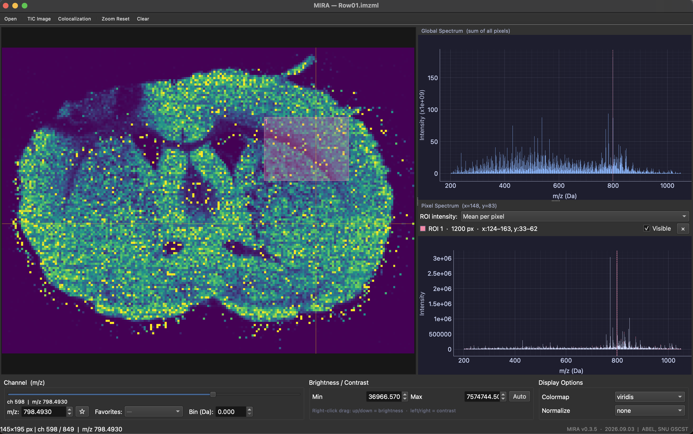

# MIRA — Mass spectrometry Imaging & Review App

[](https://doi.org/10.5281/zenodo.24354425)

**Version:** v0.3.5

**Updated:** 2026.09.03

**Project:** A standalone viewer for mass spectrometry imaging (MSI) data

MIRA opens imzML datasets (`.imzML` with the matching `.ibd`) and multi-channel TIFF images (`.tif` / `.tiff`). It combines ion-image navigation, spectrum inspection, ROI comparison, line profiles, RGB colocalization, image and spectrum export, and up to three independent viewer windows.



*MIRA v0.3.5 main window: ion image (left) with an ROI and pixel crosshair, Global Spectrum and Pixel/ROI Spectrum (right), and channel, brightness/contrast, and display controls (bottom).*

## Download

| Platform | Download |
|---|---|
| macOS 12+ (`.app`) | [GitHub Releases](https://github.com/Pulsar-kkaturi/mira-msi-viewer/releases) · [Google Drive](https://drive.google.com/drive/folders/1Orn4vtcO6TSQI6HD88bkk5fpj1vORU3q?usp=sharing) |
| Windows 10/11 (`.exe`) | [Google Drive](https://drive.google.com/drive/folders/1Orn4vtcO6TSQI6HD88bkk5fpj1vORU3q?usp=sharing) |
| Linux | In preparation (run from source; not yet tested) |

The macOS build is not code-signed. If macOS blocks the first launch, right-click `MIRA.app` → **Open**, or remove the quarantine attribute after copying it to `/Applications`:

```bash
xattr -cr /Applications/MIRA.app
```

## Requirements

- Python 3.10 or later; Python 3.11 or later is recommended
- macOS 12 Monterey or later or Windows 10/11 (Linux support is in preparation)
- The dependencies listed in `requirements.txt`

## Install and Run from Source

```bash
git clone https://github.com/Pulsar-kkaturi/mira-msi-viewer.git
cd mira-msi-viewer

python -m venv .venv
source .venv/bin/activate        # Windows: .venv\Scripts\activate

pip install -r requirements.txt
python main.py
```

For an imzML dataset, keep its `.imzML` and `.ibd` files together with the same base name. Use `File → Open File…` (`Ctrl+O` or the platform-standard Open shortcut) to open imzML or TIFF data.

## Features

- **Ion-image navigation:** channel slider, direct m/z entry, spectrum-click navigation, and `Shift + wheel` channel stepping
- **Display controls:** gray, viridis, hot, and inferno LUTs; manual Min/Max; right-drag window/level adjustment; 2%–98% Auto adjustment
- **Normalization:** None, TIC, RMS, and Median
- **Binning:** view-time Mean or Sum within a configurable Da width; optional load-time binning for high-channel-count imzML files
- **Spectra:** stem-style Global Spectrum and Pixel/ROI Spectrum plots; per-file session favorite markers; CSV export for the global spectrum and active ROIs
- **Multi-ROI comparison:** up to five numbered, color-coded rectangular ROIs with visibility, removal, pixel count, and Mean-per-pixel or Total display
- **Multi-line profiles:** up to five numbered lines, each in an independent non-modal profile window that refreshes after channel, normalization, or bin changes
- **Four-pane RGB colocalization:** synchronized Red, Green, Blue, and additive Merge panes with per-channel Min, Max, and Auto controls
- **TIC view:** display the total-ion-current image
- **Image export:** export the rendered single-channel or RGB image as PNG, JPG, or TIFF, optionally with a scale bar
- **Independent windows:** open up to three isolated MIRA windows; each owns its data and all analysis/display state
- **In-app manual:** read the bundled English manual through `Help → User Manual…`
- **Large-file operation:** imzML `.ibd` files larger than 500 MB use lazy channel reads

## Mouse and Keyboard Gestures

| Gesture | Action |
|---|---|
| Wheel | Zoom around the pointer |
| `Shift + wheel` | Step channels; upward moves to the previous channel and downward to the next |
| Left-drag | Pan the image |
| Double-click | Reset zoom |
| Right-drag vertically | Adjust brightness by shifting the display window |
| Right-drag horizontally | Adjust contrast by changing the display-window width |
| `Shift + click` | Select one pixel, draw a crosshair, and show its spectrum |
| `Shift + drag` | Add a rectangular ROI; up to five can remain active |
| `Ctrl + drag` | Add a line profile and open its popup; up to five can remain active |
| Click a spectrum | Jump to the nearest channel |

In RGB colocalization mode, the normal bottom controls and right-drag brightness adjustment are disabled because each RGB slot has its own Min/Max values. Pixel and ROI selection remain available. Creating a new line profile is disabled until the overlay is turned off.

## Controls and Analysis

### Bottom Controls

- **Channel slider / m/z field:** select a channel by index or nearest m/z value
- **Bin (Da):** aggregate channels within ±(Bin/2); `0` shows a single channel
- **Min / Max / Auto:** set the single-channel display range
- **Colormap:** select the single-channel LUT
- **Normalize:** apply None, TIC, RMS, or Median normalization

Choose `View → Bin Mode → Mean` or `Sum` to select view-time aggregation. If the pre-scan channel count exceeds the preference threshold (5,000 by default), opening an imzML file also offers load-time Da binning.

### ROI Comparison

`Shift + drag` adds the next free ROI slot. The ROI panel appears in the lower spectrum area and supports visibility toggles, per-ROI removal, and Mean-per-pixel or Total intensity. `File → Export ROI Spectra…` exports all active ROIs with their coordinates. `File → Export Global Spectrum…` exports the raw all-pixel sum.

### Line Profiles

`Ctrl + drag` creates a numbered cyan line and a corresponding non-modal popup with endpoint coordinates, geometric length, and distance-versus-intensity data. Close a popup to remove that line. `View → Clear Annotations` or the toolbar **Clear** action removes all ROIs, the pixel crosshair, and all line-profile windows without changing zoom, channel, or brightness.

### Colocalization Overlay

Use `View → Colocalization Overlay` or the toolbar **Colocalization** toggle. MIRA shows synchronized Red, Green, Blue, and additive Merge panes in a fixed-order 2×2 grid without text covering the images. The Overlay Controls panel provides Merge inclusion, channel selection, Min, Max, and Auto for each R/G/B slot. Individual tinted panes remain visible when excluded from Merge, and `File → Export Image…` saves the full grid.

### Favorite Channels

Select a channel and use the `☆`/`★` button beside the m/z/Ch field to add or remove it from favorites. The adjacent Favorites dropdown lists all saved channels in ascending axis order and jumps immediately to the selected entry. Orange short-dotted markers sit behind the blue Global Spectrum stems while the thicker pink dashed line follows the current channel. Favorites are restored per file path within the same window for the current application session; they are not persisted across restarts or shared between windows.

## Current Menus by Platform

### macOS

Qt integrates application actions into the native menu bar:

- **MIRA:** About, Preferences, and Quit are handled as native application actions
- **File:** New Window, Open File…, image/global-spectrum/ROI-spectrum export
- **View:** TIC Image, Colocalization Overlay, Reset Zoom, Clear Annotations, and Bin Mode
- **Help:** User Manual… and About MIRA…

MIRA does not create a separate Edit menu on macOS. The Preferences action is assigned `PreferencesRole` and is moved to the MIRA application menu by Qt.

### Windows and Linux

- **File:** New Window, Open File…, image/global-spectrum/ROI-spectrum export, and Quit
- **Settings:** Preferences…
- **View:** TIC Image, Colocalization Overlay, Reset Zoom, Clear Annotations, and Bin Mode
- **Help:** User Manual… and About MIRA…

Preferences currently contains the large-file channel threshold used to decide when the load-time binning dialog is shown.

## Build Standalone Applications

Install the requirements first; PyInstaller is included in `requirements.txt`.

### macOS `.app`

```bash
source .venv/bin/activate
bash build_mac.sh
# Output: packaging/dist/MIRA.app
```

Install by copying `packaging/dist/MIRA.app` to `/Applications`. If Gatekeeper blocks an unsigned local build, approve it in System Settings or remove its quarantine attribute:

```bash
xattr -cr /Applications/MIRA.app
```

### Windows `.exe`

Run on Windows:

```cmd
pip install -r requirements.txt
build_win.bat
REM Output: packaging\dist\MIRA.exe
```

The Windows build uses PyInstaller `--onefile`; the macOS build creates an application bundle. Both builds include `viewer/`, `assets/`, and the single bundled `USER_MANUAL_ENG.md`. The Korean manual and versioned manual snapshots are repository documentation and are not bundled.

## Project Structure

```text
mira-msi-viewer/
├── main.py                         # QApplication, three-window registry, window factory
├── README.md
├── LICENSE                         # GPL-3.0
├── ARCHITECTURE.md
├── CHANGELOG.md
├── USER_MANUAL_ENG.md              # Live manual bundled with the app
├── USER_MANUAL_KOR.md              # Repository-only Korean manual
├── requirements.txt
├── build_mac.sh
├── build_win.bat
├── assets/
│   ├── MIRA-LOGO_v1.png            # Product-logo source image
│   ├── AppIcon.icns
│   ├── AppIcon.ico
│   ├── ABEL_Logo1.png
│   └── SNU_GSCST_ENG.png
├── docs/
│   ├── README_KOR.md               # Korean README
│   └── manuals/                    # Versioned manual snapshots
├── tools/
│   └── convert_icon.py
├── packaging/                      # Generated PyInstaller output
└── viewer/
    ├── main_window.py              # Window composition, menus, state, and signal routing
    ├── data_model.py               # imzML/TIFF loading, spectra, normalization, and binning
    ├── image_viewer.py             # Single/RGB rendering, gestures, ROI/line overlays
    ├── spectrum_panel.py           # Global, pixel, and multi-ROI spectra
    ├── roi_panel.py                # ROI list and intensity mode
    ├── controls_panel.py           # Channel, display, bin, and normalization controls
    ├── overlay_panel.py            # R/G/B colocalization controls
    ├── line_profile_panel.py       # Distance/intensity plot
    ├── line_profile_dialog.py      # Per-line non-modal popup
    ├── export_dialog.py            # Image export options
    ├── spectral_resolution_dialog.py
    ├── settings_dialog.py
    ├── user_manual_dialog.py       # Read-only Markdown manual dialog
    └── about_dialog.py
```

## Core Dependencies

PyQt6 provides the desktop UI and built-in Markdown rendering; pyimzML reads imzML data; NumPy handles arrays; pyqtgraph draws spectra and profiles; scikit-image samples line profiles; Pillow exports images; tifffile reads TIFF data; and PyInstaller creates standalone distributions.

## License

MIRA is released under the [GNU General Public License v3.0](LICENSE). The standalone builds bundle PyQt6, which is distributed under the GPL v3, so MIRA follows the same license. The source code for each release is available from the matching tag in this repository.

## Citation

A technical paper describing MIRA is in preparation. Until it is published, please cite the software archive on Zenodo: [doi:10.5281/zenodo.24354425](https://doi.org/10.5281/zenodo.24354425) (this DOI always resolves to the latest version).

## Contact

Feedback, bug reports, and feature requests are welcome through [GitHub Issues](https://github.com/Pulsar-kkaturi/mira-msi-viewer/issues).

Developer: Jonghun Jeong · ABEL Lab, Seoul National University · jonghun.jeong@snu.ac.kr
