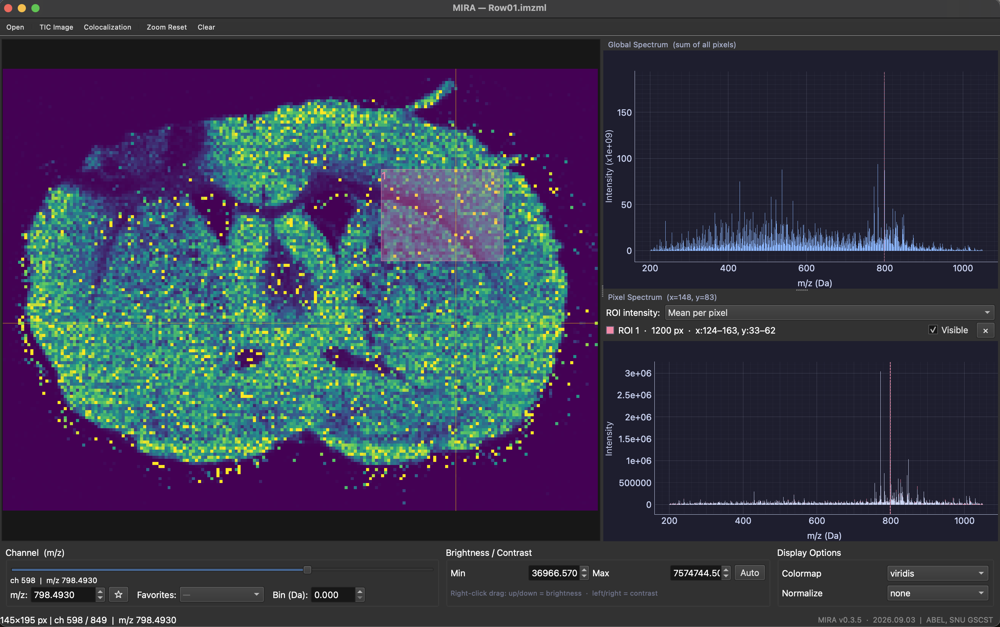

# MIRA — Mass Spectrometry Imaging & Review App

[](https://doi.org/10.5281/zenodo.24354425)

**버전:** v0.3.4
**업데이트:** 2026.08.14

Mass Spectrometry Imaging(MSI) 데이터를 탐색·비교하기 위한 독립 실행형 데스크톱 뷰어입니다. imzML(`.imzML` + `.ibd`) 및 멀티채널 TIFF(`.tif`/`.tiff`)를 열어 이온 이미지, 스펙트럼, ROI, 라인 프로파일, RGB 컬로컬라이제이션을 분석하고 결과를 내보낼 수 있습니다.

---



*MIRA v0.3.5 메인 창: ion image와 ROI·픽셀 십자선(왼쪽), Global Spectrum과 Pixel/ROI Spectrum(오른쪽), 채널·밝기/대비·표시 설정(아래).*

## 주요 기능


| 기능 | 설명 |
| --- | --- |
| **이온 이미지 탐색** | 채널 슬라이더, m/z 직접 입력, 스펙트럼 클릭, `Shift + 휠`로 채널 이동 |
| **표시 제어** | `gray` / `viridis` / `hot` / `inferno` 컬러맵, Min/Max, 우클릭 드래그, 2%–98% Auto 조정 |
| **정규화** | None, TIC, RMS, Median |
| **빈닝** | 표시 시점의 Mean/Sum Da 빈닝 및 대용량 imzML의 로드 시점 빈닝 |
| **스펙트럼** | 전체 raw 합계와 픽셀·ROI raw 스펙트럼을 stem plot으로 비교하고 CSV로 내보내기 |
| **다중 ROI 비교** | 번호·색상으로 구분되는 사각형 ROI를 최대 5개까지 추가, 표시/삭제 및 Mean per pixel·Total 비교 |
| **다중 라인 프로파일** | 최대 5개 선의 거리 대 강도 프로파일을 각각 독립적인 비모달 팝업에서 확인 |
| **RGB 컬로컬라이제이션** | R/G/B별 채널과 Min/Max를 독립 설정해 이온 이미지를 가산 RGB 합성 |
| **TIC 이미지** | 전체 채널을 픽셀별로 합산한 Total Ion Current 이미지 표시 |
| **이미지 내보내기** | 현재 렌더링된 단일 채널 또는 RGB 이미지를 PNG/JPG/TIFF와 스케일 바로 저장 |
| **독립 창** | 데이터와 분석 상태를 각자 보유하는 MIRA 창을 최대 3개까지 열기 |
| **내장 매뉴얼** | `Help → User Manual…`에서 번들 영문 사용자 매뉴얼 열기 |
| **파일·대용량 지원** | Continuous/Processed imzML, 2D·멀티채널 TIFF 지원 및 500 MB 초과 `.ibd` lazy loading |


---


## 다운로드

| 플랫폼 | 다운로드 |
|---|---|
| macOS 12 이상 (`.app`) | [GitHub Releases](https://github.com/Pulsar-kkaturi/mira-msi-viewer/releases) · [Google Drive](https://drive.google.com/drive/folders/1Orn4vtcO6TSQI6HD88bkk5fpj1vORU3q?usp=sharing) |
| Windows 10/11 (`.exe`) | [Google Drive](https://drive.google.com/drive/folders/1Orn4vtcO6TSQI6HD88bkk5fpj1vORU3q?usp=sharing) |
| Linux | 준비 중 (소스 실행만 가능, 아직 검증하지 않음) |

macOS 빌드는 코드 서명이 되어 있지 않습니다. 처음 실행할 때 막히면 `MIRA.app`을 우클릭 → **열기**를 선택하거나, `/Applications`에 복사한 뒤 `xattr -cr /Applications/MIRA.app`을 실행하세요.

## 요구사항

- Python 3.10 이상 (3.11 이상 권장)
- macOS 12 (Monterey) 이상 또는 Windows 10/11 (Linux 지원은 준비 중)

---


## 설치 및 실행


### A. 소스에서 직접 실행 (개발 / 테스트용)

```bash
# 1. 저장소 클론
git clone https://github.com/Pulsar-kkaturi/mira-msi-viewer.git
cd mira-msi-viewer

# 2. 가상환경 생성 (선택, Python 3.11+ 권장)
python -m venv .venv           # 또는: uv venv --python 3.11 .venv
source .venv/bin/activate      # Windows: .venv\Scripts\activate

# 3. 의존성 설치
pip install -r requirements.txt

# 4. 실행
python main.py
```


### B. Mac .app 번들 빌드 및 설치

```bash
# 1. 의존성 설치
uv venv --python 3.11 .venv
uv pip install -r requirements.txt

# 2. 빌드 실행
source .venv/bin/activate
bash build_mac.sh # uv run bash build_mac.sh
# → packaging/dist/MIRA.app 생성

# 3. 설치
cp -r packaging/dist/MIRA.app /Applications/
# 또는 Finder에서 packaging/dist/MIRA.app을 Applications 폴더로 드래그
```

> **첫 실행 시 macOS 보안 경고가 뜨면:**  
> 시스템 환경설정 → 보안 및 개인 정보 보호 → "그래도 열기" 클릭  
> 또는 터미널에서: `xattr -cr /Applications/MIRA.app`


### C. Windows .exe 빌드


#### 방법 1: 로컬 Windows 머신에서 직접 빌드

```cmd
:: 사전 준비
:: Python 설치 시 "Add Python to PATH" 반드시 체크

:: 1. 의존성 설치
pip install -r requirements.txt pyinstaller

:: 2. 빌드 실행 (CMD에서)
build_win.bat
:: → packaging\dist\MIRA.exe 생성
```

> **참고:** `build_win.bat`을 더블클릭해도 실행할 수 있습니다.  
> 오류 발생 시 CMD에서 실행하면 오류 메시지를 확인할 수 있습니다.


#### 방법 2: GitHub Actions CI (Windows 머신 없이 빌드)

버전 태그를 푸시하면 자동으로 Windows `.exe`가 빌드됩니다.

```bash
git tag v0.3.4
git push origin v0.3.4
```

빌드 완료 후 GitHub 저장소 → **Actions** 탭 → 해당 워크플로 → **Artifacts**에서  
`MIRA-windows-v0.2.3` 아티팩트를 다운로드하고 압축을 해제하면 단일 실행 파일
`MIRA.exe`를 사용할 수 있습니다.

또는 GitHub Actions 탭에서 수동으로 **Run workflow**를 클릭해도 됩니다.

---


## 사용법


### 파일 열기

- `File → Open File…` 또는 `Ctrl+O`
- `.imzML`, `.tif`, `.tiff` 파일 지원
- imzML은 같은 폴더의 `.ibd` 파일이 자동으로 함께 로드됩니다
- TIFF 채널은 물리 m/z 값 대신 채널 인덱스로 표시됩니다. 4D TIFF는 첫 번째 Z/T 슬라이스를 사용합니다.
- 사전 채널 수가 환경설정 임계값보다 큰 imzML을 열면 **Full resolution** 또는 Da 폭을 지정한 **load-time binning**을 선택할 수 있습니다.
- 파일을 읽는 동안 진행 상태가 표시되며, 로드 후 상태 표시줄에서 크기·채널 수·데이터 모드·로드 시 빈 폭을 확인할 수 있습니다.


### 창과 화면 구성

- `File → New Window`로 최대 **3개**의 독립 MIRA 창을 열 수 있습니다. 각 창은 데이터, 줌, 표시 설정, ROI, 라인 프로파일, RGB 오버레이 상태를 별도로 보유합니다.
- 화면 왼쪽은 이온 이미지, 오른쪽은 **Global Spectrum**과 **Pixel/ROI Spectrum**, 하단은 채널·표시·정규화·빈닝 컨트롤입니다.
- RGB 컬로컬라이제이션을 켜면 하단에 **Overlay Controls (R/G/B)** 패널이 나타납니다.


### 마우스 조작


| 동작 | 기능 |
| --- | --- |
| **마우스 휠** | 포인터 위치를 중심으로 줌 인/아웃 |
| **Shift + 휠** | 줌 변경 없이 이전/다음 m/z 또는 채널로 이동 |
| **좌클릭 드래그** | 이미지 팬(이동) |
| **Shift + 클릭** | 픽셀 하나를 선택하고 노란 크로스헤어 및 해당 raw 스펙트럼 표시 |
| **Shift + 좌클릭 드래그** | 사각형 ROI 추가(최대 5개) |
| **Ctrl + 좌클릭 드래그** | 라인 프로파일 추가(최대 5개) |
| **더블클릭** | 줌을 화면 맞춤 상태로 리셋 |
| **우클릭 드래그 상하** | 표시 범위를 이동해 밝기 조절 |
| **우클릭 드래그 좌우** | 표시 범위 폭을 변경해 대비 조절 |
| **스펙트럼 클릭** | 클릭한 x 위치와 가장 가까운 채널로 이동 |


### 스펙트럼과 ROI 비교

- **Global Spectrum**은 모든 픽셀의 raw intensity 합계입니다. **Pixel/ROI Spectrum**은 선택한 픽셀과 표시 중인 ROI 스펙트럼을 보여줍니다.
- `Shift + 클릭`으로 픽셀을 선택합니다. ROI를 추가하면 ROI 비교를 위해 기존 픽셀 곡선과 크로스헤어가 지워집니다.
- `Shift + 드래그`로 만든 사각형 ROI는 1–5번의 고정 색상 슬롯을 순서대로 사용합니다. 각 ROI는 표시 여부를 전환하거나 개별 삭제할 수 있습니다.
- ROI intensity는 **Mean per pixel**(영역 픽셀별 평균) 또는 **Total**(모든 픽셀의 합계)로 선택합니다. ROI·픽셀·전체 스펙트럼은 항상 raw 값이므로 이미지 정규화나 표시 시점 빈닝의 영향을 받지 않습니다.
- `File → Export Global Spectrum…`은 전체 raw 합계를, `File → Export ROI Spectra…`는 활성 ROI를 CSV로 저장합니다. 숨긴 ROI도 활성 상태이면 CSV에 포함됩니다.


### 라인 프로파일

- `Ctrl + 좌클릭 드래그`로 선을 그리면 번호가 붙은 cyan 선과 별도의 비모달 **Line Profile N** 팝업이 열립니다. 팝업에는 양 끝점, 길이(px), 거리 대 강도 그래프가 표시됩니다.
- 채널, 정규화 또는 표시 시점 빈닝이 바뀌면 활성 라인의 프로파일도 자동으로 갱신됩니다.
- 팝업을 닫으면 해당 라인이 삭제되고 슬롯이 비어 새 라인에 재사용됩니다.
- 툴바 **Clear** 또는 `View → Clear Annotations`는 모든 ROI, 픽셀 크로스헤어, 라인과 라인 프로파일 팝업을 제거합니다. 줌·채널·밝기 설정은 유지됩니다.


### 컨트롤 패널 (하단)

- **Channel 슬라이더**: m/z 채널 탐색
- **m/z / Ch 입력 필드**: 값을 확정하면 가장 가까운 m/z 또는 TIFF 채널로 이동
- **Bin (Da)**: 선택 채널 중심 `±(Bin/2)` 범위의 채널을 집계 (`0` = 단일 채널)
- **View → Bin Mode**: Mean / Sum 선택
- **Min / Max 스핀박스**: 밝기/대비 수동 입력
- **Auto 버튼**: 표시 채널의 0이 아닌 값 2 percentile과 전체 값 98 percentile로 표시 범위를 자동 조정
- **Colormap / Normalize**: 표시 옵션

`None`, `TIC`, `RMS`, `Median` 정규화는 표시 이미지, 표시 시점 빈 이미지, 라인 프로파일에 적용됩니다. Global·Pixel·ROI 스펙트럼은 raw 값을 유지합니다. 로드 시점 빈닝은 m/z 축 자체를 변경하므로 이후 모든 이미지와 스펙트럼에 반영됩니다.


### RGB 컬로컬라이제이션과 TIC

- `View → Colocalization Overlay` 또는 툴바 **Colocalization**을 켜면 R/G/B별로 포함 여부, m/z(또는 Ch), Min, Max, Auto를 설정할 수 있습니다. 활성 슬롯은 각각 0–255으로 스케일링된 뒤 가산 RGB 합성됩니다.
- RGB 모드에서는 단일 채널용 채널·밝기·컬러맵·정규화·빈닝 컨트롤, 우클릭 밝기/대비, 새 라인 프로파일 생성은 사용할 수 없습니다. 픽셀 및 ROI 선택은 계속 가능합니다.
- `File → Export Image…`는 현재 렌더링된 단일 채널 또는 RGB 합성을 PNG, JPG, TIFF로 저장합니다. µm/nm/px 단위의 스케일 바 길이와 위치를 선택할 수 있으며, 주석은 이미지에 포함되지 않습니다.
- `View → Show TIC Image` 또는 툴바 **TIC Image**는 모든 채널의 픽셀별 합인 TIC 이미지를 표시하고 2/98 percentile 범위를 자동 적용합니다. TIC를 표시하면 RGB 오버레이는 종료됩니다.


### 환경설정

macOS의 `MIRA → Preferences…` 또는 Windows/Linux의 `Settings → Preferences…`에서 다음을 설정할 수 있습니다:


| 설정 | 설명 |
| --- | --- |
| **Large-file channel threshold** | imzML 채널 수가 이 값을 초과하면 로드 시 스펙트럼 해상도/빈닝 선택 다이얼로그 표시. 기본값은 5,000, 설정 범위는 1,000–100,000 채널이며 세션 간 저장됩니다. |

---


## 파일 구조

```
mira-msi-viewer/
├── main.py                         # QApplication, 창 레지스트리와 창 생성
├── README.md                       # 영문 프로젝트 안내
├── LICENSE                          # GPL-3.0
├── ARCHITECTURE.md                  # 아키텍처 문서
├── CHANGELOG.md                     # 변경 이력
├── USER_MANUAL_ENG.md               # 앱에 포함되는 영문 사용자 매뉴얼
├── USER_MANUAL_KOR.md               # 저장소용 한글 사용자 매뉴얼
├── requirements.txt                 # Python 의존성
├── build_mac.sh / build_win.bat     # macOS / Windows 빌드 스크립트
├── assets/
│   ├── MIRA-LOGO_v1.png             # 제품 로고
│   ├── AppIcon.icns / AppIcon.ico   # 앱 아이콘
│   └── ABEL_Logo1.png / SNU_GSCST_ENG.png
├── docs/
│   ├── README_KOR.md                # 한글 안내 (이 문서)
│   └── manuals/                     # 버전별 매뉴얼 스냅샷
├── tools/
│   └── convert_icon.py              # .icns → .ico 변환 스크립트
├── packaging/                       # PyInstaller 생성 결과물
└── viewer/
    ├── main_window.py               # 창 구성, 메뉴, 상태 및 신호 연결
    ├── data_model.py                # imzML/TIFF 로딩, 스펙트럼, 정규화, 빈닝
    ├── image_viewer.py              # 단일/RGB 렌더링과 제스처·주석 오버레이
    ├── spectrum_panel.py / roi_panel.py
    ├── controls_panel.py            # 채널·표시·빈닝·정규화 컨트롤
    ├── overlay_panel.py             # R/G/B 컬로컬라이제이션 컨트롤
    ├── line_profile_dialog.py       # 라인별 비모달 프로파일 팝업
    ├── export_dialog.py             # 이미지 내보내기 설정
    ├── spectral_resolution_dialog.py # 로드 시 빈닝 선택
    ├── settings_dialog.py           # 환경설정
    ├── user_manual_dialog.py        # 내장 매뉴얼 뷰어
    └── about_dialog.py              # About 다이얼로그
```

---


## 의존성

```
PyQt6          – GUI 프레임워크
pyimzml        – imzML 파일 파싱
numpy          – 배열 처리
pyqtgraph      – 실시간 스펙트럼 플롯
scikit-image   – 이미지 처리 유틸
Pillow         – 이미지 변환 및 내보내기
tifffile       – 멀티채널 TIFF 파일 파싱
PyInstaller    – .app / .exe 번들 패키징
```

> 추후 v1.0 정식 배포 시 영문·한글 `PACKAGING_GUIDE` 작성으로 확장 예정.

## 라이선스

MIRA는 [GNU General Public License v3.0](../LICENSE)으로 배포합니다. 독립 실행 빌드에 GPL v3로 배포되는 PyQt6가 포함되므로 같은 license를 따릅니다. 각 릴리스의 소스는 이 저장소의 해당 tag에서 받을 수 있습니다.

## 인용

MIRA 기술 논문을 준비 중입니다. 논문이 나오기 전까지는 Zenodo 아카이브를 인용해 주세요: [doi:10.5281/zenodo.24354425](https://doi.org/10.5281/zenodo.24354425) (이 DOI는 항상 최신 버전을 가리킵니다).

## 문의

피드백, 버그 제보, 기능 요청은 [GitHub Issues](https://github.com/Pulsar-kkaturi/mira-msi-viewer/issues)로 남겨 주세요.

개발자: 정종훈 (Jonghun Jeong) · ABEL Lab, 서울대학교 · jonghun.jeong@snu.ac.kr
